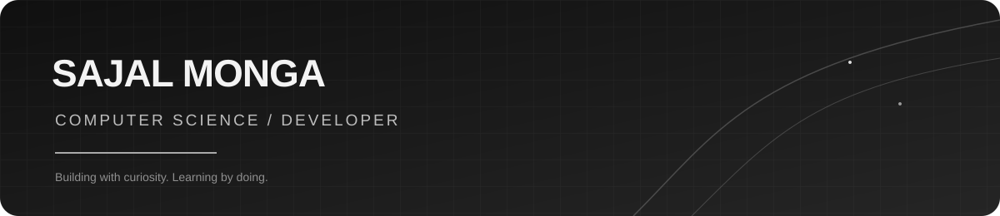
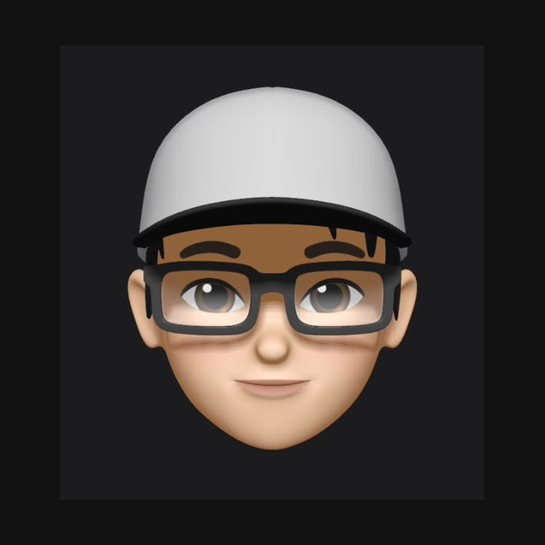
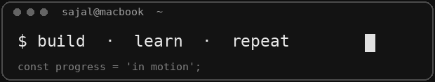

 

<table>
  <tr>
    <td width="150" align="center" valign="middle">
      
    </td>
    <td valign="middle">
      <h2>Hi, I'm Sajal.</h2>
      
<strong>Computer Science Student · Developer</strong>

      
Interested in software, the web, and the details that make things work.

      

        <a href="mailto:Sajal.22422@stu.upes.ac.in">Email</a>
        &nbsp;·&nbsp;
        <a href="https://github.com/isajal-11">GitHub</a>
      

    </td>
  </tr>
</table>

---

### About

My interest in programming started at 11, when I began experimenting with Scratch and discovered how a few blocks of logic could bring an idea to life. That curiosity led me to Python and, over time, to C and the wider world of software development.

These days, I'm exploring web development with HTML, CSS, and JavaScript, while getting hands-on with tools such as Docker and macOS. I enjoy understanding how things work, experimenting with new ideas, and turning what I learn into practical projects.

### Technologies

### What I'm working towards

- Writing cleaner, more reliable code in C and Python.
- Building responsive interfaces with HTML, CSS, and JavaScript.
- Understanding containers and development workflows with Docker.
- Applying what I learn through practical projects.

---

**Have an interesting idea or want to connect?**

<a href="mailto:Sajal.22422@stu.upes.ac.in">Sajal.22422@stu.upes.ac.in</a>

New ideas welcome.

